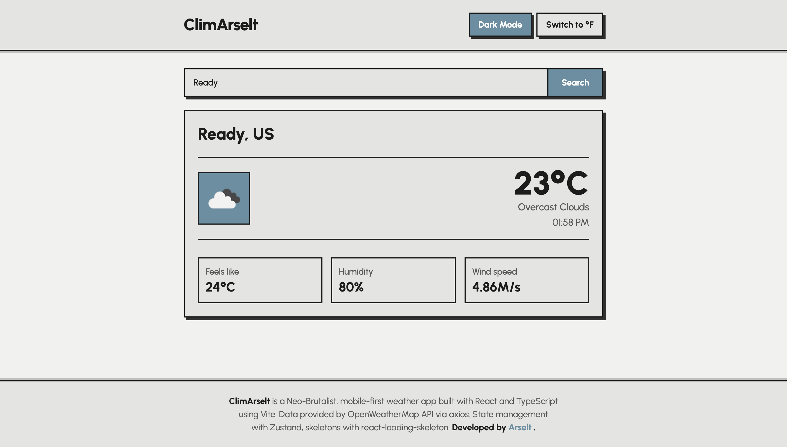

# 🌦️ React Weather

React Weather is a web application that fetches weather data from the OpenWeather API. Built with React, TypeScript, and Vite, it provides real-time weather information, allowing users to search for weather by city name or coordinates.


## Live Demo
<a href="https://climarselt.netlify.app/" target="_blank" rel="noopener noreferrer">🚀 Deploy</a>
<a href="https://github.com/arselt/react-weather" target="_blank" rel="noopener noreferrer">📄 GitHub Repository</a>



## Features
- Fetches and displays weather data from OpenWeather API
- Support for both metric and imperial units
- Current weather conditions: feels like, humidity, wind (with direction), pressure, sunrise and sunset in the city's local time
- Next 24 hours (3-hour steps) with rain chance, and a 5-day forecast with daily min/max
- Air quality index with the main pollutants (PM2.5, PM10, NO₂, O₃)
- City search and "Use my location" (browser geolocation)
- Saved cities (favorites) and recent searches, kept in the browser
- Desktop layout with a sidebar; the weather panel adapts to its own width with Tailwind container queries
- Press `/` to jump to the search box
- Responsive mobile first design
- Secure API key handling using Netlify Functions

## Installation

To run this project locally, follow these steps:

1. Clone the repository:
   ```sh
   git clone https://github.com/arselt/react-weather.git
   cd react-weather
   ```
2. Install dependencies (requires Node 22.12+ and pnpm, pinned via `packageManager`):
   ```sh
   pnpm install
   ```
3. Get an API key from [OpenWeather](https://openweathermap.org/api) and create a `.env` file in the project directory:
   ```sh
   VITE_API_KEY=your_openweather_api_key_here
   ```
4. Start the development server:
   ```sh
   pnpm dev
   ```
5. Run the unit tests for the weather utilities:
   ```sh
   pnpm test
   ```

## Deployment to Netlify

This project uses Netlify Functions to securely handle API requests without exposing your API key in the frontend code.

1. Fork or clone this repository to your GitHub account
2. Connect your repository to Netlify
3. Add the following environment variable in Netlify site settings:
   - Key: `OPENWEATHER_API_KEY`
   - Value: Your OpenWeather API key
4. Deploy the site

The project automatically uses the local API key during development and switches to Netlify Functions in production.

## Technologies Used
- React 19
- TypeScript
- Vite
- Axios for API requests
- Zustand for state management
- Tailwind CSS for styling
- React Loading Skeleton for loading states
- Netlify Functions for secure API handling
